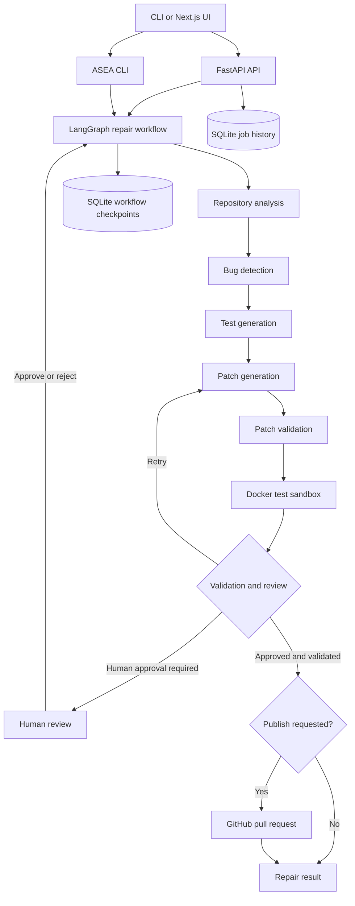

# ASEA — Autonomous Software Engineering Agent

ASEA is a multi-agent software engineering system that analyzes Python repositories, identifies potential bugs, generates tests and patches, validates changes in an isolated Docker sandbox, and supports human-reviewed repair workflows. Approved, validated repairs can optionally be published as GitHub pull requests.

> **Project status:** Python 3.12+ prototype. ASEA currently analyzes and repairs Python repositories only. It is designed for supervised repair: every proposed patch is reviewed, validated in an isolated test container, and never silently merged.

## What it does

- Builds a repository map and analyzes Python code.
- Detects bugs using static and dependency-aware analysis.
- Generates tests and candidate code patches.
- Runs repository tests in a constrained Docker container (read-only source mount, networking disabled, resource limits).
- Reviews patches and retries failed repairs with validation feedback.
- Exposes repair jobs and review actions through a FastAPI backend.
- Persists repair history and workflow checkpoints in SQLite.
- Offers a Next.js interface for analysis, repair progress, review, and history.
- Can publish validated and approved repairs through an opt-in GitHub pull request workflow.

ASEA does **not** silently merge pull requests. Publishing is opt-in, and patches requiring review pause for a human decision.

## Architecture



## Requirements

- Python 3.12 or newer
- Git
- Docker Engine/Desktop running locally
- Node.js 22 and npm (for the web frontend)
- An OpenAI-compatible LLM endpoint; the checked-in example configuration targets Ollama

The Docker sandbox image is built from `Dockerfile.sandbox`. ASEA uses the Docker daemon to create isolated test containers, so Docker must be available to the account running the backend or CLI.

## Installation

Clone the repository and enter its root directory:

```bash
git clone https://github.com/Mohammad-Ashhar/Autonomous_Software_Engineering_Agent_-ASEA-.git
cd Autonomous_Software_Engineering_Agent_-ASEA-
```

Create and activate a virtual environment:

```bash
python -m venv .venv
# Windows PowerShell
.venv\Scripts\Activate.ps1
# macOS / Linux
source .venv/bin/activate
```

Install the project with API and development dependencies:

```bash
python -m pip install --upgrade pip
python -m pip install -e ".[api,dev]"
```

Build the sandbox image:

```bash
docker build -t asea-sandbox:py312 -f Dockerfile.sandbox .
```

## Configure the LLM and GitHub integration

Copy the example environment file:

```bash
# Windows PowerShell
Copy-Item .env.example .env
# macOS / Linux
cp .env.example .env
```

The supported settings in `.env.example` are:

| Variable | Purpose | Default |
| --- | --- | --- |
| `ASEA_ENV` | Runtime environment (`development` or `production`) | `development` |
| `ASEA_API_KEY` | Optional shared Bearer key protecting API routes; required in production mode | Empty |
| `OLLAMA_BASE_URL` | OpenAI-compatible Ollama API endpoint | `http://localhost:11434/v1` |
| `OLLAMA_MODEL` | Model name sent to the configured LLM endpoint | `qwen2.5-coder:1.5b` |
| `GITHUB_TOKEN` | GitHub token used by GitHub integration / PR publishing | Empty |
| `GITHUB_REPOSITORY` | Repository used by the publishing integration | Empty in application defaults |
| `GITHUB_BASE_BRANCH` | Target base branch for publishing | `MohammadAshhar/deepseek-langraph` |

For the default configuration, install and start Ollama, then pull the configured model:

```bash
ollama pull qwen2.5-coder:1.5b
ollama serve
```

If you change the model or endpoint, update `OLLAMA_MODEL` and `OLLAMA_BASE_URL` accordingly. The endpoint must provide the OpenAI-compatible API expected by the configured LLM client.

Set `GITHUB_TOKEN` only when using GitHub operations that require authentication, such as publishing pull requests. Use a token with the minimum repository permissions required. Never commit `.env`, tokens, or other credentials.

For a production backend, set `ASEA_ENV=production` and provide a high-entropy `ASEA_API_KEY`. The API refuses to start in production mode without this key. When configured, all routes except `/health` require `Authorization: Bearer <ASEA_API_KEY>`; CORS preflight requests remain available. Keep the key in server-side secret storage and never place it in a `NEXT_PUBLIC_*` frontend variable.

## Run ASEA

### CLI

Analyze a local repository:

```bash
asea analyze ./path/to/python-repository
```

Analyze a GitHub repository:

```bash
asea analyze https://github.com/owner/repository
```

Run the repair workflow without publishing:

```bash
asea repair ./path/to/python-repository
```

Opt in to GitHub pull-request publishing:

```bash
asea repair ./path/to/python-repository --publish
```

Display the active environment configuration:

```bash
asea status
```

### End-to-end repair demonstration

The included `demo_repo_multi/` fixture contains a deliberate defect: `is_positive(0)` incorrectly returns `True`, and its regression test catches the problem. Use it to walk through the repair workflow without publishing anything:

1. Confirm the fixture starts with a failing test:

   ```bash
   cd demo_repo_multi
   python -m pytest -q
   cd ..
   ```

2. Run ASEA against the fixture:

   ```bash
   asea repair ./demo_repo_multi
   ```

3. Follow the workflow output as ASEA analyzes the repository, generates a candidate patch, and validates it in the Docker sandbox. Review the resulting diff before accepting it. This local demo does not request GitHub publishing.

Build the sandbox image and configure the LLM before running the repair demonstration, as described above. The fixture is intentionally faulty; do not use it as application code.

#### Evaluator quick check

For a short, reproducible walkthrough:

1. Run `asea --help` and `asea status` to verify the installed CLI and configuration.
2. Run the two commands above in the repository root. The first should fail on the deliberately introduced zero-boundary defect.
3. Start the repair workflow and inspect the proposed diff at the human-review prompt. Approve only if the change is correct.
4. Confirm the workflow summary reports `COMPLETED`, all final tests pass, and the change is present in the ASEA workspace. Add `--publish` only when you intentionally want a GitHub pull request.

The repair workflow's duration depends on the local model, whether it is already loaded, repository size, and test-suite duration. A warm small model and a small repository can make the demo substantially faster; this project does not claim a fixed 30–60 second runtime. Each Ollama request has a 60-second timeout and automatic retries are disabled, so a stalled model call fails fast instead of silently retrying for several minutes. Existing test suites are reused rather than generating new tests, which avoids unnecessary model calls for the included demo. The default Docker test-runner timeout is 120 seconds per test run.

CLI exit codes: `0` means the command completed successfully and (for repair) final validation passed; `1` means a command or runtime error; `2` means the repair workflow finished without full validation, so publishing is blocked.


### Backend API

Start the FastAPI development server:

```bash
python -m asea.api.main
```

The API listens on `http://127.0.0.1:8000`. Interactive API documentation is available at `http://127.0.0.1:8000/docs`.

| Method | Endpoint | Purpose |
| --- | --- | --- |
| `GET` | `/` | API welcome/status response |
| `GET` | `/health` | Liveness check |
| `GET` | `/ready` | Readiness check for initialized workflow and SQLite job storage |
| `POST` | `/analyze` | Analyze a repository |
| `POST` | `/repair` | Submit a repair job (returns HTTP 202) |
| `GET` | `/repair/{job_id}` | Retrieve one repair job |
| `GET` | `/repairs` | Paginated repair history; supports `limit`, `offset`, and `status` |
| `POST` | `/repair/{job_id}/review` | Approve or reject a pending patch |

Example repair request:

```bash
curl -X POST http://127.0.0.1:8000/repair \
  -H "Content-Type: application/json" \
  -d '{"repository":"https://github.com/owner/repository","publish":false}'
```

A repair response contains a `job_id`. Poll `GET /repair/{job_id}` to follow its state. If a patch is awaiting review, submit a decision to `POST /repair/{job_id}/review` with JSON such as:

```json
{"decision":"approved","feedback":""}
```

For a rejection, provide non-empty feedback:

```json
{"decision":"rejected","feedback":"The proposed change does not handle the empty-input case."}
```

The API accepts `publish: true` as an explicit opt-in. A pull request is attempted only after the workflow completes its approval and validation path.

### Web frontend

In a second terminal:

```bash
cd frontend
npm ci
npm run dev
```

Open `http://localhost:3000`. By default, the frontend calls the API at `http://127.0.0.1:8000`. To use a different backend URL, set `NEXT_PUBLIC_API_URL` in the frontend environment before starting/building the app.

For a production frontend build:

```bash
npm run lint
npm run build
npm run start
```

## Persistence and recovery

The API stores runtime data under the repository's `data/` directory. Active repair admission is bounded by `ASEA_MAX_ACTIVE_REPAIR_JOBS` (default 20, maximum 500). Admission is serialized with a SQLite write transaction, so concurrent API processes share the same capacity limit; submissions at capacity receive HTTP 503 with `Retry-After: 30`. Old completed/failed records can be pruned with `repair_jobs.prune_terminal_jobs(retention_days=30)`. Active and review-paused jobs are preserved.

Runtime data files:

- `data/asea_jobs.db` — repair job history, status, review request, result, and publishing preference.
- `data/asea_checkpoints.db` — LangGraph workflow checkpoints used to resume jobs awaiting human review.

Keep this directory on persistent storage if repair history and review checkpoints must survive process restarts. On API startup, queued or running jobs left by a previous process are marked failed; jobs waiting for human review are preserved so their checkpoint can be resumed.

Do not delete or modify these databases while the API is running.

## Security and operational boundaries

- API-key authentication is available for backend clients. Production mode requires `ASEA_API_KEY`; use a high-entropy secret and protect it with server-side secret storage. This is a shared-key boundary, not user identity, role-based authorization, or multi-user isolation.
- The API's default server binding is loopback (`127.0.0.1`). Do not expose it directly to the public internet. For a browser frontend, put a properly authenticated reverse proxy or identity-aware gateway in front of the API; do not embed the shared API key in browser code.
- CORS is currently restricted to the local frontend origins `localhost:3000` and `127.0.0.1:3000`.
- Before remote deployment, use a trusted reverse proxy or API gateway for TLS termination, identity/authorization where needed, shared rate limiting, request/resource limits, and deployment-specific CORS. Keep API secrets in server-side secret storage.
- Treat repository code, test output, and LLM-generated patches as untrusted. Review diffs before accepting them.
- The test runner mounts the target repository read-only, disables container networking, and applies memory, CPU, process, and timeout limits. This is defense in depth, not a guarantee that arbitrary code is safe.
- Docker test-runner settings are validated before connecting to Docker: timeout must be 1–3600 seconds, and memory must be 16 MiB–8 GiB (for example, `512m`). Empty image names and malformed resource values are rejected at startup.
- Use a dedicated Docker host/account and avoid granting ASEA broader host privileges than necessary.
- GitHub publishing is opt-in. Keep tokens out of source control and grant only the permissions needed to create branches and pull requests.

## Development and tests

Run code-quality checks and tests locally:

```bash
ruff check asea tests
python -m compileall -q asea tests
python -m pytest tests/ -v
```

Run the frontend checks:

```bash
cd frontend
npm ci
npm run lint
npm run build
```

The GitHub Actions workflow runs Python linting, compilation, Docker sandbox image build, frontend lint/build, and the Python test suite on pushes and pull requests to the configured branches.

## Troubleshooting

**Docker connection errors**
- Start Docker Desktop / Docker Engine.
- Confirm the current user can access the Docker daemon.
- Build the expected image with `docker build -t asea-sandbox:py312 -f Dockerfile.sandbox .`.

**LLM connection or model errors**
- Confirm Ollama is running and reachable at `OLLAMA_BASE_URL`.
- Confirm the model named by `OLLAMA_MODEL` is installed.
- Check that the configured endpoint supports the OpenAI-compatible API.

**Frontend cannot connect to the backend**
- Start the API on port 8000.
- Check `NEXT_PUBLIC_API_URL` and the browser console.
- Confirm the backend is reachable from the browser and the request origin is allowed by CORS.

**A repair is waiting for review**
- Retrieve the job with `GET /repair/{job_id}`.
- Submit an approval or a rejection with actionable feedback to the review endpoint.
- If scheduling a review fails temporarily, the job is returned to the review queue and can be submitted again.

**A job is marked interrupted after restart**
- Queued/running work is not automatically replayed after an API process restart. Start a new repair job.
- Jobs already waiting for human review retain their checkpoint and can be reviewed after restart.

## Current scope

ASEA is under active development. The current analyzer, test-generation, and repair workflow is primarily designed for Python repositories. The API supports shared Bearer-key authentication in production mode, request-size limits, and per-process rate limiting. It does not provide user identity, role-based authorization, multi-user isolation, distributed rate limiting, or distributed workers. Before a remote deployment, place the API behind a trusted reverse proxy or API gateway, configure deployment-specific CORS and shared rate limiting there, and use managed secret storage. Do not expose the development server directly to the public internet.


### API request protections

The API applies a per-process, per-client sliding-window rate limit and rejects request bodies larger than 2 MiB by default. Configure these limits with `ASEA_RATE_LIMIT_REQUESTS`, `ASEA_RATE_LIMIT_WINDOW_SECONDS`, and `ASEA_MAX_REQUEST_BODY_BYTES`. Rate-limit responses use HTTP 429 and include `Retry-After`. The `/health` endpoint and CORS preflight requests are exempt.

Responses include baseline browser security headers. CORS permits only the configured local frontend origins, GET/POST/OPTIONS methods, and Authorization/Content-Type headers. The in-memory limiter is per process; multi-worker or multi-instance deployments must also enforce shared limits at a trusted reverse proxy or API gateway.
